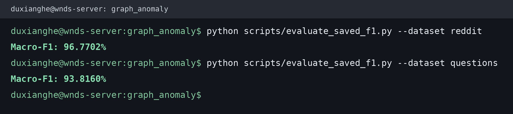

# SCRAD: Aligning LLMs with Graph Anomaly Detection via Retrieval-Augmented Sequence Coherence Discrimination


| Dataset | Nodes | Original Undirected Edges | Features | Anomaly Ratio After Injection | Train/Validation/Test | Macro-F1 |
|---|---:|---:|---:|---:|---|---:|
| Reddit (Reddit2) | 232,965 | 11,606,919 | 602 | 4.8% | 40%/20%/40% | 96.7702% |
| Question | 48,921 | 153,540 | 301 | 7.3% | 40%/20%/40% | 93.8160% |

The values are full-test-set results from completed single-seed experiments.



## Download

[Baidu Netdisk files](https://pan.baidu.com/s/11LeQ_Q6Wwk5A7C9Ylrv4ew?pwd=y6mm) — Extraction code: `y6mm`

| File | Purpose |
|---|---|
| `data.zip` | The two datasets before and after anomaly injection, including fixed splits |
| `scrad-weight.tar.gz` | Trained checkpoints |
| `scrad-contexts.tar.gz` | Retrieval bank, KG inputs, sequences, encodings, and test labels |
| `scrad-deepseek14b-awq.tar.gz` | DeepSeek model and tokenizer |
| `scrad-predictions.tar.gz` | Approximately 8.1 MB; contains node-level predictions for the complete test sets of both datasets and Macro-F1 results |

Inference also requires the `weights/`, `artifacts/`, and `models/` directories. Extract the corresponding resource archives into the project root directory.

[Original source of the DeepSeek AWQ weights](https://huggingface.co/casperhansen/deepseek-r1-distill-qwen-14b-awq/tree/bc43ec1bbf08de53452630806d5989208b4186db)

## Dataset Package

The `scrad-datasets.tar.gz` dataset package is approximately 1.30 GB and contains the Reddit and Questions datasets before and after anomaly injection. If the files are repackaged as ZIP on Baidu Netdisk, the archive may be named `data.zip`.

| Dataset | Directory Before Injection | Directory After Injection | Anomalous Nodes After Injection | Train/Validation/Test Nodes |
|---|---|---|---:|---|
| Reddit | `data/original/reddit/` | `data/reddit/` | 11,182 (approximately 4.8%) | 93,186 / 46,593 / 93,186 |
| Questions | `data/original/questions/` | `data/questions/` | 3,571 (approximately 7.3%) | 19,568 / 9,784 / 19,569 |

Each directory contains `<dataset>.npz` (node features, labels, and splits), `<dataset>_adj.npz` (sparse adjacency matrix), and `dataset.json` (statistics), where `dataset` is either `reddit` or `questions`.

## Complete Test Prediction Package

The `scrad-predictions.tar.gz` archive is approximately 8.1 MB and contains node-level predictions for the complete test sets of both datasets and their Macro-F1 results.

| Dataset | Prediction File | Test Nodes |
|---|---|---:|
| Reddit | `reference/reddit/predictions.jsonl` | 93,186 |
| Questions | `reference/questions/predictions.jsonl` | 19,569 |

## Installation

Python 3.11; training and LLM inference require a CUDA GPU. The reference environment uses an A100 80GB GPU.

```bash
python -m pip install -r requirements.txt
tar -xzf scrad-weights.tar.gz
tar -xzf scrad-contexts.tar.gz
tar -xzf scrad-deepseek14b-awq.tar.gz
```

## Inference

```bash
python infer.py --dataset questions --gpus 0
python infer.py --dataset reddit --gpus 0,1
```

## Training

PMP is trained for 200 epochs, the dual-level encoder for 50 epochs, single-view LLM alignment for 300 steps, and joint alignment for 25 steps. The LLM weights are frozen.

```bash
python train.py --dataset questions --gpu 0
python train.py --dataset reddit --gpu 0
python infer.py --dataset questions --run runs/questions/prepared --checkpoint runs/questions/joint25/last.pt --gpus 0
python infer.py --dataset reddit --run runs/reddit/prepared --checkpoint runs/reddit/joint25/last.pt --gpus 0,1
```

The `--stage` option supports `pretrain`, `prepare`, `single300`, and `joint25`. Logs are saved under `runs/<dataset>/`. Retraining is not guaranteed to produce bitwise-identical results across different hardware.

## Recomputing Macro-F1

Extract the complete test predictions and the corresponding labels from the contexts archive, then run the following commands on a CPU:

```bash
tar -xzf scrad-predictions.tar.gz
tar -xzf scrad-contexts.tar.gz artifacts/reddit/evaluation.npz artifacts/questions/evaluation.npz
python scripts/evaluate_saved_f1.py --dataset reddit
python scripts/evaluate_saved_f1.py --dataset questions
```

The outputs are `Macro-F1: 96.7702%` and `Macro-F1: 93.8160%`, respectively.

You can use `--predictions` and `--labels` to specify prediction and label files at other locations.
